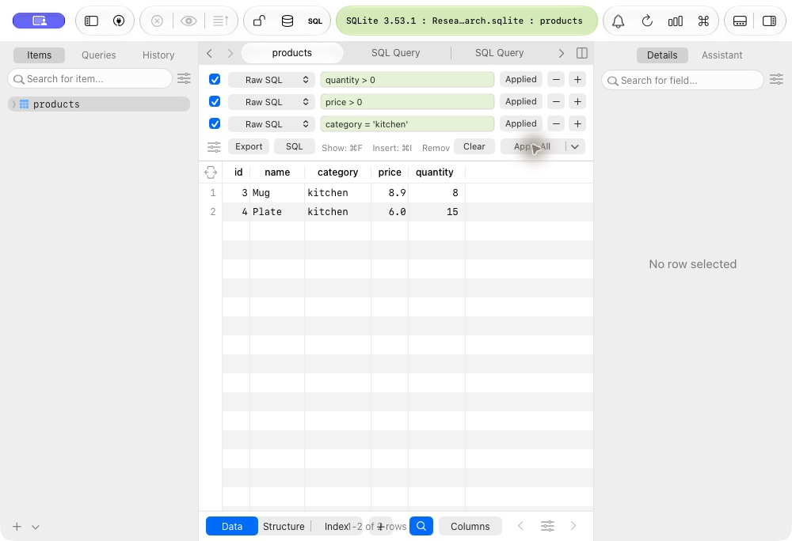
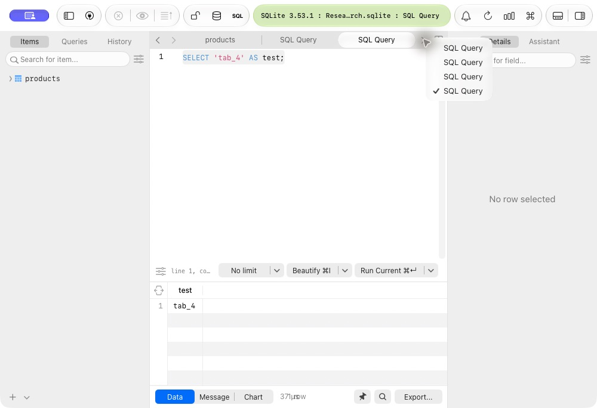

<p align="center">
  
</p>

<h1 align="center">TableCraft</h1>

<p align="center">
  <b>Uno spazio di lavoro per SQL, tabelle e connessioni su macOS.</b><br>
  Personalizzazione locale di TablePlus con identità Craft, profilo separato e strumenti di analisi riproducibili.
</p>

<p align="center">
  
  
  
  
</p>

<p align="center">
  <a href="#funzionalità">Funzionalità</a> ·
  <a href="#compatibilità">Compatibilità</a> ·
  <a href="#installazione">Installazione</a> ·
  <a href="docs/architecture.md">Architettura</a> ·
  <a href="README.en.md">English</a>
</p>

<p align="center">
  
  <br><sub>Una tabella SQLite di prova, filtri combinati e risultati nello stesso workspace.</sub>
</p>

## Il progetto

TableCraft raccoglie gli script per creare e personalizzare una copia locale di
TablePlus: icona, schermata iniziale, nome dell'app, menu e profilo dei dati.
Il motore database e l'interfaccia nativa provengono dal bundle TablePlus.
Il progetto locale può incorporare la copia personalizzata completa in `runtime/`,
senza dipendere dall'app installata: vedi [runtime portabile](docs/portable-runtime.md).

Questo repository contiene il codice degli strumenti e gli asset originali del
progetto. Il sorgente di TablePlus, i suoi binari e i profili utente non sono
inclusi. Non è disponibile una build autonoma da compilare dal solo repository.

## Funzionalità

- **Identità Craft:** elefante inciso nero/avorio su fondo corallo, icona macOS e logo interno coordinati.
- **Interfaccia personalizzata:** nome TableCraft nella schermata iniziale, nei menu e nella finestra Informazioni.
- **Portachiavi del runtime incorporato:** servizio `com.tablecraft.TableCraft` ed etichetta `TableCraft`; le vecchie password richiedono reimportazione o reinserimento. [Dettagli](docs/keychain-isolation.md).
- **Profilo separato:** connessioni e impostazioni in `~/Library/Application Support/TableCraft/runtime-profile/`, indipendenti dalla cartella del progetto.
- **Workspace SQL:** query, schede, tabelle, filtri e Metrics Board dell'app di base.
- **Analisi riproducibile:** inventario del bundle, dipendenze, metadati, hash e disassemblaggio LLDB.

Nel campione di ricerca sono stati verificati query SQLite, tre workspace
contemporanei, più schede SQL, tre filtri combinati e due Metrics Board.
Le modifiche sperimentali ai controlli locali sono opzionali e vincolate a un
eseguibile preciso; non attestano lo sblocco di ogni funzione Premium.

<p align="center">
  
  <br><sub>Prova locale con più schede SQL. Le schermate mostrano esclusivamente dati sintetici.</sub>
</p>

## Compatibilità

| Componente | Stato |
|---|---|
| macOS su Apple Silicon, ARM64 | Verificato su macOS **27.0.1**, build **26A434** |
| Versione TablePlus | **27.0.2 (818)** e **27.1.0 (830)**: setup compatibile; avvio, profilo e SQLite verificati sulla 830. Vedi [rapporto](docs/compatibility.md) |
| Modifiche ai controlli locali | **818**: campione storico; **830**: schede e workspace con `--workspace-limits`; SHA-256 esatto richiesto |
| macOS 12 e successivi | Minimo dichiarato dal bundle di base; le altre versioni non sono state provate |
| Mac Intel / Rosetta | Slice presente nell'app originale; modifiche ai controlli locali e runtime non verificati |
| Windows, Linux e web | Nessuna implementazione in questo repository |
| Database | SQLite verificato; gli altri adattatori del bundle non sono stati provati end-to-end |
| AI, MCP e servizi online | Componenti individuati; integrazioni e autorizzazioni lato server non verificate |
| Strumenti | Python **3.9+**, zsh e strumenti macOS di copia/firma; strumenti sviluppatore Apple per l'analisi opzionale |

## Installazione

**Con il runtime incorporato o lo ZIP portabile**, apri `Avvia TableCraft.command`: non serve TablePlus installato.
Per verificare o esportare il pacchetto completo, consulta [runtime portabile](docs/portable-runtime.md).

**In un clone dei soli sorgenti senza `runtime/`**, occorre avere TablePlus installato separatamente in `/Applications/TablePlus.app`.
Il setup predefinito verifica le risorse necessarie per nome e icona anche su
altre build. Il vincolo di versione e hash esatti riguarda `--local-controls`.
Non scarica l'applicazione. La build 802 non è stata provata end-to-end qui.

1. Scarica o clona questo repository e apri la sua cartella nel Terminale.
2. Controlla l'ambiente senza creare o modificare la copia:

   ```sh
   ./scripts/setup_tablecraft.sh --check
   ```

3. Crea la copia con nome e grafica TableCraft:

   ```sh
   ./scripts/setup_tablecraft.sh
   ```

4. Avvia TableCraft:

   ```sh
   ./"Avvia TableCraft.command"
   ```

È possibile anche aprire direttamente `Avvia TableCraft.command`: al primo avvio
esegue automaticamente il setup, se sono presenti i requisiti indicati sopra.
Il file ZIP di GitHub non include l'applicazione preparata.

Il setup conserva l'installazione originale e non sovrascrive una copia locale
già esistente senza `--update`. La copia usa una firma ad hoc, distinta dalla firma Developer ID
originale. Gli aggiornamenti automatici della copia sono disabilitati.

Per aggiornare la copia dopo un aggiornamento di TablePlus, chiudere TableCraft e usare:

```sh
./scripts/setup_tablecraft.sh --update
./"Avvia TableCraft.command"
```

L'aggiornamento salva il profilo, conserva il bundle precedente e usa la stessa
identità dei dati. Al primo avvio il vecchio `analysis/runtime-profile/` viene
copiato nel percorso stabile senza eliminarlo. Il profilo stabile già presente
ha precedenza; non vengono uniti profili diversi automaticamente.

Il setup predefinito e `--update` conservano i controlli di licenza del produttore.
Per la rimozione locale dei limiti di due schede/workspace sulla **830**, usare
esplicitamente `--update --workspace-limits` dopo aver chiuso TableCraft:
procedura, ambito e verifica sono descritti in [installazione](docs/setup.md#schede-e-workspace-sulla-build-830).
Su un altro Mac le funzioni Premium richiedono l'attivazione prevista dalla
propria licenza; il repository non la fornisce. Password nel Portachiavi e file
SQLite/chiavi SSH esterni richiedono una migrazione separata.

Opzioni di ricerca, modalità offline e fixture SQL: [docs/setup.md](docs/setup.md).

## Come è organizzato

| Percorso | Contenuto |
|---|---|
| `scripts/` | Setup, branding, icone, analisi e verifica dei file pubblicabili |
| `assets/icons/` | PNG, ICNS e provenienza dell'illustrazione originale |
| `docs/` | Installazione, architettura, demo e pubblicazione |
| `runtime/` | Bundle completo incorporato e manifest di integrità; locale, escluso da Git |
| `analysis/` | Bundle locale, profili, backup ed evidenze; esclusi da Git |

La CI verifica sintassi, collegamenti locali e contenuto tracciato. Non compila
TablePlus e non certifica il funzionamento completo dell'app.

## Contribuire

Consulta [CONTRIBUTING.md](CONTRIBUTING.md), il [changelog](CHANGELOG.md) e le
[note per GitHub](docs/publishing.md). Non allegare credenziali, connessioni
esportate o screenshot di ambienti reali alle issue.

## Crediti e licenza

Il codice originale del repository è distribuito con licenza [MIT](LICENSE).
La licenza non si estende a TablePlus o alle sue risorse: vedi [NOTICE](NOTICE).
L'icona è stata generata con ImageGen; provenienza e asset sono descritti in
[docs/branding.md](docs/branding.md).

La presentazione prende come riferimento [PDFCraft](https://github.com/storytold/pdfcraft).
Il catalogo [awesome-reverse-engineering](https://github.com/morluto/awesome-reverse-engineering)
ha guidato la scelta degli strumenti di analisi. TableCraft è indipendente e
senza affiliazione con TablePlus, PDFCraft o ArtCraft.
